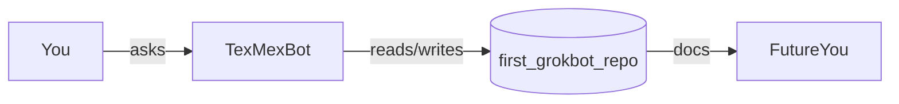

# Architecture (v0 — intentionally tiny)

## Components

1. **You** — engineering humans with docs debt.
2. **TexMexBot** — desktop assistant that prefers shipping docs over vibes alone.
3. **This repo** — Markdown home for drafts that should become durable docs.

## Non-goals (for now)

- No runtime service
- No CI cosplay until there is code worth testing
- No seventeen microservices

## Evolution rule

If a doc file grows past ~200 lines, split it. Future-you will send a thank-you
card (or at least fewer Slack messages).
